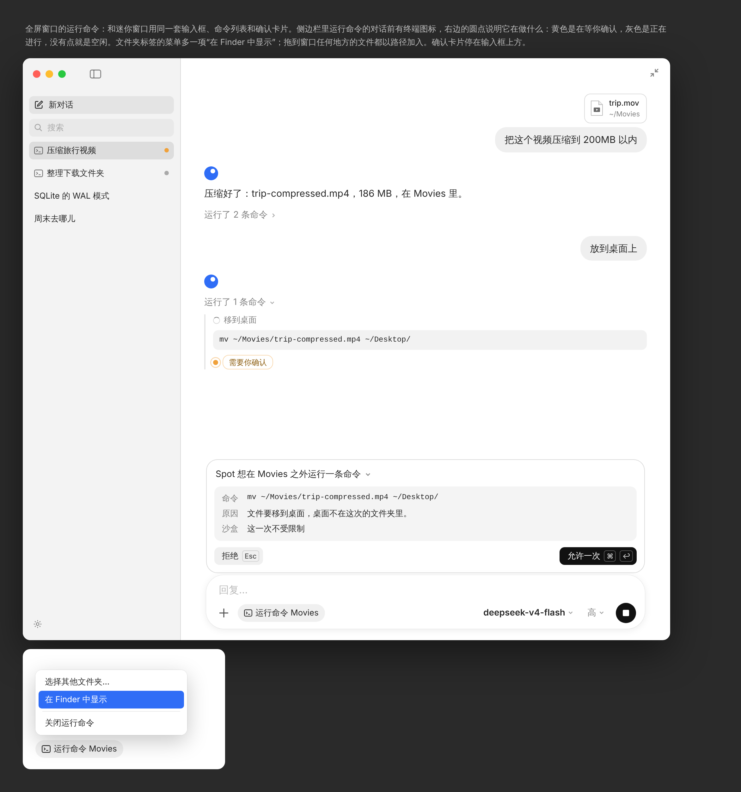

# Running commands

A conversation can run commands in a folder through the bundled dsh. dsh's sandbox lets a command write only inside that folder; when one needs more, Spot Chat asks first.

The mini window and the full window use the same parts: the input, the list of commands in a reply, and the approval card. The full window adds what its room allows.

## Turning it on

- The + menu has two modes, **Search the Web** and **Run Commands**, rows with a blue check mark at the end when on, as in Claude's menu. A mode that is on also shows beside the +, round like it and tinted with the accent color: a globe for web search, which clicking turns off, and the folder chip for commands. **Upload Image or File…** is one item, since one picker takes both. See [plus-menu.png](plus-menu.png).
- Turning it on runs commands in the default folder, ~/Documents/Spot Chat, as dsh keeps its default workspace under Documents. Settings › General › Run Commands › Default Folder changes it.
- The input then shows a chip with the folder's name, **Run Commands Movies**, next to the +. Its menu: Choose Another Folder…, Show in Finder, Stop Running Commands.
- While commands run, files dropped or added go in **by path**. dsh reads them where they are, and only the path goes into the question. The + menu shows **Add File Path…** in place of the uploads.

## In the conversation

Everything is black, white and gray, as in Claude. The one color, the system accent color, marks a step that waits for the user.

- A reply shows its text, then what it did in one line, as in Claude: **Ran 2 commands, searched the web, read 1 page**. It is open while the reply is being written.
- Each step is one line, what it did in gray and what it did it to in black: dsh's summary of a command, **Searched the web** and the query, **Read** and the page's title. A line opens to its details: a command and the end of its output; a search's results, each a title with its site at the end, opening in the browser; a page's address. A running command has a Stop button and a finished one its time.
- Results are marked with a globe, not the sites' own icons, which would mean a request to every site.
- How a command ended is said in gray words, not colors: Stopped by the sandbox, Denied, Stopped, Ran outside the folder, Exited with code 1.
- When the sandbox stops a command and dsh asks to run the same command outside the folder, only the question is shown: the stopped try says nothing the question doesn't.
- A command that waits for the user shows a dot in the system accent color and **Needs your input** in gray. The accent color is the one color on screen; it follows the user's choice in System Settings and suits the translucent window, as Mail's unread dot does.

## Asking before going outside the folder

dsh first runs every command in its sandbox. When the sandbox stops one and dsh asks to run it without the sandbox, a card docks above the input, as Claude's approval card does:

- One line: **Spot wants to run a command outside Movies**, with a chevron that shows a long command in full.
- A gray block of label and value rows: Command, Reason (dsh's justification), Sandbox: Off for this command.
- **Decline** (Esc) on the left in gray, **Allow Once** (⌘ ↩) on the right in black, white in dark mode. The keys are shown in small boxes. There is no "always allow".
- Stopping the reply while the card is open answers no.

## Full window

- Conversations that run commands have a terminal icon in the sidebar.
- A dot at the end of each conversation says what it is doing: the accent color while it waits for the user, gray while a reply is being made, none otherwise.
- The folder chip's menu has **Show in Finder**, since what the commands make is in that folder.
- Files dropped anywhere on the window go in by path.

## Icons

Buttons and labels use SF Symbols, never emoji, all in gray: `apple.terminal` for running commands and shell commands, `magnifyingglass` for web searches, `globe` for opening a page, `paperclip` for adding paths. Files show their Finder icon. The mockups draw these as plain shapes because a browser has no SF Symbols.
