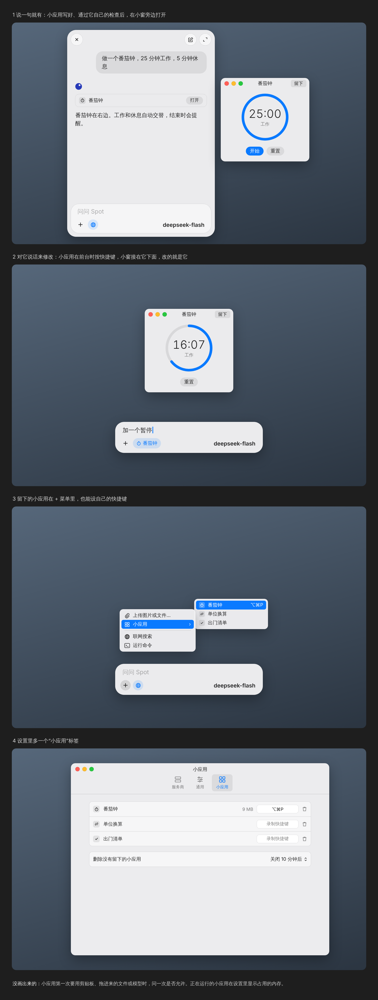

# Mini apps

A mini app is a small program the model writes when asked: a timer, a unit converter, a packing list, a few
sliders. It opens as an ordinary macOS window beside Spot Chat and runs as real code, so a converter gives the
same right answer every time, works offline and answers a click at once. It is temporary unless kept, and it
changes when you tell it to.



## How it is used

- **Making one.** Ask in the mini window ("a pomodoro timer, 25 minutes work, 5 rest"). The model decides to
  make an app, as it decides to search the web, and writes it. Spot Chat runs the app's checks, and the reply
  shows a step for the app with Open. The app's window opens beside the mini window.
- **Using it.** The window has the traffic lights, the app's name and Keep. Its controls are native ones in the
  app's colors and fonts, with the system accent color. It can take what you're working with: the selected
  text when it opens, the clipboard, files dropped on it.
- **Changing it.** With an app's window in front, the Spot Chat shortcut opens the mini window under it, with
  a chip naming the app. What you ask then changes that app, and its window updates in place, keeping the
  values it holds where the new version still has them.
- **Keeping it.** An app you don't keep is deleted 10 minutes after its window closes, as the mini window
  keeps a closed conversation. A kept app is listed in the + menu under Mini Apps, can have its own shortcut,
  and appears in Spotlight and Shortcuts.
- **Settings › Mini Apps** lists the kept apps with their shortcuts, the memory of the ones running, and
  Delete, and sets when apps that weren't kept are deleted.

## What an app is

A folder in `~/Library/Application Support/Spot Chat/Apps/<id>/`:

- `app.json`: the name, an SF Symbol, what the app is allowed to use, its interface, its initial data, and its
  checks.
- `logic.js`: what happens when a button is pressed, a value changes or a timer fires.
- `data.json`: what a kept app stores between launches.

### The interface: A2UI

The interface is described in [A2UI](https://github.com/a2ui-project/a2ui) v1.0, Google's format for
interfaces an agent describes and a client draws, which became the current stable version on 2026-11-05
(Apache-2.0). A component list refers to a data model by path; inputs bind to it both ways, and buttons send
actions. Using it means the model writes a documented format rather than one invented here.

Spot Chat draws a catalog of its own: from A2UI's basic catalog Text, Image, Icon, Row, Column, List, Card,
Divider, Button, TextField, CheckBox, ChoicePicker, Slider and DateTimeInput, plus ProgressRing, NumberField,
Table and DropZone, which the basic catalog lacks. They are drawn with SwiftUI in the app's style.

Spot Chat has its own renderer for this catalog instead of A2UI's SwiftUI package: that package is alpha, has
no release tags, and depends on swift-syntax through an open version range, which CI's Swift 6.1 can't be
held to; and every component has to look like the rest of Spot Chat anyway.

### The logic: a script in the agent's place

A2UI has no logic of its own: no arithmetic, no clock, and inputs don't send events. In A2UI, an agent
answers the actions and pushes data updates; in a mini app, `logic.js` plays that part:

```js
export const state = { phase: "work", left: 1500, running: false }

export function start(state, spot) {
  spot.every(1000, "tick")
  return { ...state, running: true }
}

export function tick(state, spot) {
  if (state.left > 1) return { ...state, left: state.left - 1 }
  spot.notify(state.phase === "work" ? "Time for a break" : "Back to work")
  return state.phase === "work"
    ? { ...state, phase: "rest", left: 300 }
    : { ...state, phase: "work", left: 1500 }
}
```

Each handler takes the data model and returns the new one; Spot Chat sends the change to the interface as
an A2UI data update. Inputs that the script must hear name a handler in `app.json`, which Spot Chat calls
when the value changes.

`spot` offers what the app declared in `app.json`, and nothing else: timers and notifications; reading the
selection, clipboard or a dropped file; writing the clipboard; storage for a kept app; asking the model. The
first time an app uses the clipboard, a file or the model, Spot Chat asks once, as it asks before a command
outside the folder.

### Checks

`app.json` holds checks the model writes with the app: actions to send and what the data must then hold
("after convert with 5 and 3, `result` is 1.6667"). Spot Chat runs them before opening the app and after
every change; when one fails, the failure goes back to the model, which fixes the app, up to three times.
Then the app opens, or the reply says what still fails.

## Running it

- **The interface** is drawn in Spot Chat itself, in a normal window per app.
- **The logic** runs in SpotChatApps, a helper process like SpotChatWriter, with one JavaScriptCore context
  per open app. A handler gets a second; one that takes longer, or a crash, stops the helper, which restarts,
  and that app shows that it stopped. JavaScriptCore can only be stopped mid-script through a private call,
  so a process that can be killed is the public way to keep a stuck script from freezing Spot Chat.
- **The helper runs only while an app is open**, and Settings shows each running app's memory, measured
  rather than estimated.
- **Spotlight and Shortcuts:** each kept app is an App Intents entity indexed in Spotlight with an intent that
  opens it, and one App Shortcut, Open Mini App, whose list of apps is refreshed when the kept apps change.
  This is all in the macOS 15.5 SDK that CI's Xcode 16.4 has. Whether an ad-hoc signed build registers its
  intents is not documented either way, so that part is tried on a Mac first.

## Logging

Making, checking, opening, changing, keeping and deleting an app; every handler call with its time; what the
checks reported; what an app was allowed and what it was refused; the helper's start, stop, restarts and
memory. Never the clipboard's or a file's contents.

## Order of work

Mini apps start once the reports from the current alpha are fixed, so the new layer isn't built on bugs.

1. The helper, the renderer with the catalog, making an app from a request with its checks, the window,
   Keep, and deleting apps that weren't kept.
2. Changing an app by talking to it, and the selection, clipboard and dropped files.
3. The + menu list, an app's own shortcut, Spotlight and Shortcuts, after the signing test.
4. Asking the model from an app.

## For the owner to decide

- The name: Mini Apps / 小应用.
- Whether the model decides when to make an app, as drawn, or apps are made only from the + menu.
- Whether apps may ask the model (step 4): it makes them more capable, and costs a request each time.
- Whether a mini app may ever be a web page, for 3D or drawing, which native components can't do.
